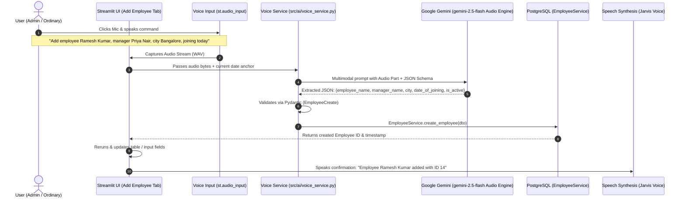

# 🎙️ Jarvis Voice Assistant: Implementation Plan for Voice-Driven "Add Employee"

## 1. Executive Summary & Objective

The objective is to introduce **Jarvis-like bidirectional voice communication** into the Employee Management application. 

Starting with the **"➕ Add Employee"** tab, users will be able to either:
1. **Type manually** using the existing input form fields.
2. **Speak naturally** by clicking a microphone button (e.g., *"Jarvis, add a new employee named Ramesh Kumar, reporting to Priya Nair in Bangalore, joining today"*).

The voice system will capture the audio, process it using **Google Gemini multimodal audio understanding**, extract and validate the fields against `EmployeeCreate`, save the record automatically into **PostgreSQL**, and speak back an audio confirmation like Jarvis.

Once validated on the **Add Employee** workflow, this voice framework will be expanded to the other tabs (Search, Edit, Deactivate, and Chatbot).

---

## 2. Architecture & Data Flow

---

## 3. Core Modules & Implementation Details

### Module 1: Dedicated Voice Service (`src/ai/voice_service.py`)
A modular service responsible for:
- **Audio Ingestion**: Accepts raw audio bytes (from `st.audio_input`) or pre-transcribed text.
- **Multimodal Gemini Parsing**: Uses Google Gemini's audio capability (`google.genai` / `types.Part.from_bytes`) to transcribe and simultaneously extract structured fields in a single step with zero audio transcoding latency.
- **Natural Date Resolution**: Resolves phrases like *"today"*, *"yesterday"*, *"next Monday"*, or *"joined March 15th"* relative to `datetime.date.today()`.
- **Validation**: Enforces `EmployeeCreate` schema rules (non-empty name, sanitized optional strings, valid date formats).
- **Missing Field Detection**: If the user omits required information (e.g., forgets the employee's name), returns an intelligent prompt explaining what is missing.

### Module 2: Streamlit UI Integration (`app.py`)
Enhance the **"➕ Add Employee"** tab:
1. **Dual-Mode Layout**:
   - **Jarvis Voice Bar**: Prominently placed at the top of the tab with an animated microphone widget (`st.audio_input`), status indicators, and quick sample voice prompts.
   - **Auto-Commit vs. Review Toggle**:
     - *Direct Commit (Jarvis Autonomous Mode)*: Directly commits to PostgreSQL upon hearing the command and displays a celebration banner + details card.
     - *Review First*: Auto-populates the manual form fields so the user can verify before pressing "Submit".
2. **Jarvis Voice Feedback (TTS)**:
   - Plays an audio voice response via browser speech synthesis (`window.speechSynthesis`), responding:
     > *"Affirmative! Employee Ramesh Kumar has been successfully registered in Bangalore with ID 14."*
3. **Activity Transcript**:
   - Displays what Jarvis heard (voice transcript) and the extracted parameters for full transparency.

### Module 3: Test Suite (`tests/test_voice_service.py`)
- Unit tests for date resolution logic.
- Mocked multimodal audio/text extraction tests.
- Validation tests verifying error handling when required fields (like employee name) are missing.
- Integration test ensuring `create_employee` integrates smoothly with voice extraction outputs.

---

## 4. User Experience Walkthrough

| Step | User Action | System Reaction |
| :--- | :--- | :--- |
| **1** | Clicks microphone button on "➕ Add Employee" | Widget begins recording audio from browser microphone. |
| **2** | Speaks: *"Add employee Anita Desai, manager Vikram Malhotra, city Pune, joining today"* | Waveform indicator shows recording. User clicks stop. |
| **3** | Audio submitted | Spinner: *"🤖 Jarvis is analyzing voice command..."* |
| **4** | Instant DB Commit | Record saved to PostgreSQL; assigned new ID; table cache updated. |
| **5** | Visual & Audio Response | Green success card appears with full employee details + Jarvis speaks back confirmation. |

---

## 5. Technology Stack for Voice

| Requirement | Selected Technology | Why Selected |
| :--- | :--- | :--- |
| **Voice Capture** | `st.audio_input` (Streamlit 1.66) | Built-in, zero external dependencies, native browser microphone handling. |
| **Speech Understanding & Extraction** | Google Gemini (`gemini-2.5-flash`) | Multimodal audio support directly processes WAV/MP3 bytes and returns structured JSON in ~1 second. |
| **Data Validation** | Pydantic v2 (`EmployeeCreate`) | Reuses existing robust schema validators from `src/schemas.py`. |
| **Database Persistence** | SQLAlchemy + `EmployeeService` | Uses the existing connection pool and transaction rollback protection. |
| **Voice Feedback (TTS)** | Web Speech API (`speechSynthesis`) | Zero latency, runs entirely client-side without downloading heavy TTS audio files. |

---

## 6. Phased Rollout Schedule

1. **Phase 1 (Current Scope)**: Implement Jarvis Voice for **Add Employee** (Voice recording + Gemini multimodal extraction + Auto-commit + Voice feedback).
2. **Phase 2**: Extend voice commands to **Search / View** (*"Show me all active employees in Bangalore"*).
3. **Phase 3**: Extend voice commands to **Edit & Deactivate** (*"Deactivate employee ID 8"* with voice confirmation).
4. **Phase 4**: Full Voice-enabled Conversational AI Chatbot tab.
